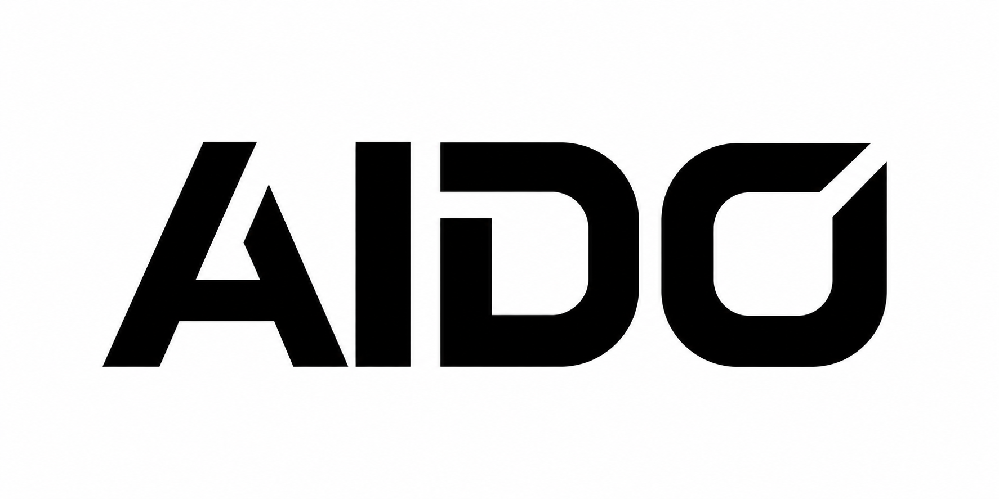
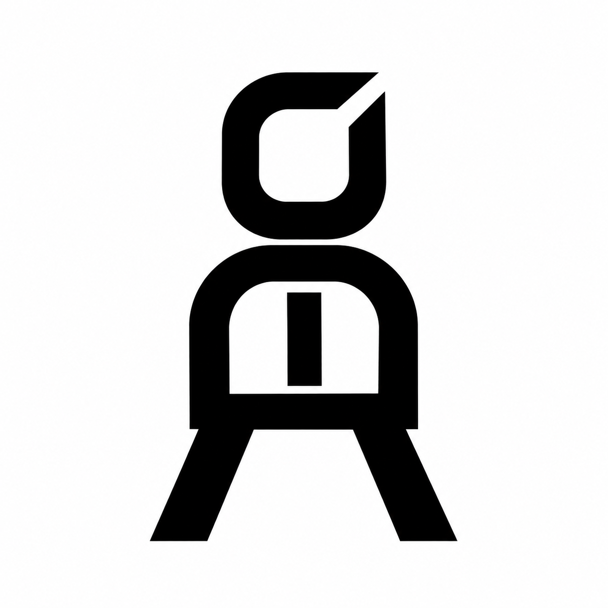
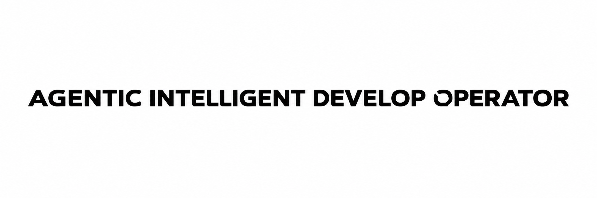

<div align="center">
  
  <br/>
  
  <br/>
  
  <br/><br/>
  <p><b>Dein persönlicher, lokaler Desktop-Begleiter für Windows 11</b></p>
  <p><i>Lokaler Windows-Assistent · Animierter MONO · Qwen-Chat · Freigaben für Desktop-Aktionen</i></p>
</div>

---

# AIDO — Agentic Intelligent Developing Operator

**AIDO** (**Agentic Intelligent Developing Operator**) ist ein persönlicher, animierter Desktop-Begleiter für Windows 11, der Menschen ohne technische Vorkenntnisse bei der Bedienung, Organisation, Entwicklung und Pflege ihres Computers unterstützt.

> **„AIDO denkt für dich. Nicht du für AIDO.“**  
> **„Dein PC. Dein AIDO. Deine Daten.“**

## AIDO-MONO 3D-Charakter & Markenidentität

AIDO tritt dem Nutzer als **MONO** gegenüber — eine minimalistisch-architektonische 3D-Figur, die aus den vier Buchstaben **A-I-D-O** geformt ist:

- **Echtes 3D-GLB-Modell (`public/assets/AIDO-MONO.glb`):**
  - **3 artikulierte Nodes:**
    - `Node 0: MONO · O head` (1.832 Vertices, 9.348 Indices): Autonome Schwebung (Hover), neigt sich neugierig bei Spracheingabe (*Listening*), nickt bejahend bei Sprachausgabe (*Speaking*), scannt aufmerksam bei Modell-Inferenz (*Thinking*).
    - `Node 1: MONO · D chassis and A legs` (1.372 Vertices, 6.912 Indices): Geometrischer Rumpf und Beine im Satin-Graphite-Material.
    - `Node 2: MONO · I core` (68 Vertices, 276 Indices): Zentraler, pulsierender Energiekern mit zustandsabhängigem Leuchten (Smaragdgrün `#10B981` bei *Listening*, Cyan `#38BDF8` bei *Thinking*).
  - **Geometrie-Gesamtumfang:** 3.272 Vertices, 16.536 Indices, 140 KB kompakte glTF 2.0 Binary-Datei.
  - **PBR-Material (`MONO · satin graphite`):** Obsidian-Schwarz (`baseColor: #14171F`), Metallic 0.08, Roughness 0.42 mit dynamischem 3-Punkt Studio-Lighting (Key, Fill, Rim).
- **Zero-Dependency WebGL Renderer (`src/mono3d.ts`):**
  - 100 % offline-lauffähig ohne CDN-Bibliotheken (kein externes Three.js/Babylon.js).
  - Volle Interaktivität: Maus-Drag für freie 360°-Rotation, Mausrad für Zoom, Doppelklick für Kamera-Reset.
- **3-stufiger Ansichts-Switcher:**
  - `🧊 3D MONO (.glb)`: Interaktives WebGL-Echtzeit-Mesh mit artikulierter Physik.
  - `✨ Morph-Animation`: Die vollständige, mathematisch exakte CSS-SVG-Transformation aus der [Landingpage](landingpage/index.html).
  - `🎯 2D Logo`: Scharfe 2D-Vektor-Silhouette (`AIDO-MONO-Charakter.png`).
- **Offizielle Marken-Assets (`public/assets/` & `landingpage/assets/`):**
  - `AIDO-Wortmarke.png` (1.774 × 887 px)
  - `AIDO-MONO-Charakter.png` (1.254 × 1.254 px)
  - `AIDO-Ausgeschriebener-Name.png` (2.172 × 724 px)
  - `AIDO-MONO.glb` (140.924 Bytes)

## Projektstand

AIDO läuft als nativer Windows-Companion mit animiertem MONO, lokalem Qwen-Chat und Einrichtungsassistent. Der installierte Build 0.1.2 wurde mit der Antigravity-Projektöffnung, dem Blender-Start nach Freigabe, der lesenden REA-6.7.0-Ressourcenanalyse und der WSL2-/Windows-Qwen-Laufzeit abgenommen. Der Werkzeugkatalog zeigt erkannte Projekte, Programme und lokale Skills.

Der Rust-Kern und die Browser-Vorschau enthalten Grundlagen für Gedächtnis, Proaktivität, Systempflege, App-Adapter und Android. Der aktuelle Funktionsstand, offene Abnahmen und die nächsten Desktop-Meilensteine stehen im [Projektstatus](docs/PROJECT_STATUS.md) und in der [Roadmap](docs/ROADMAP.md).

## AIDO unter Windows installieren

Voraussetzungen für den Build sind Node.js, Rust mit dem Windows-MSVC-Toolchain und die Microsoft C++ Build Tools. Die App verwendet Microsoft Edge WebView2.

```powershell
npm ci
$env:Path = "$env:USERPROFILE\.cargo\bin;$env:Path"
npm run tauri -- build -- --locked
```

Öffne `src-tauri\target\release\bundle\nsis\AIDO_0.1.2_x64-setup.exe`. AIDO wird für den aktuellen Windows-Benutzer installiert. Beim ersten Start führt die App durch Datenschutz, Zugriffe, Projektordner, Modell und Werkzeuge. Der Installer enthält REA 6.7.0 mit einer eigenen Node.js-Laufzeit. Die REA-Funktion in AIDO liest Ressourcen-Metadaten einer ausgewählten Windows-Programmdatei.

Auf dem Referenz-PC ist die **Windows-Laufzeit** für den lokalen Chat geprüft. Für die offene WSL2-Abnahme im Modellschritt **Ubuntu in WSL2 → WSL2-Profil erkennen** wählen. Die GPU-fähige Linux-Laufzeit liegt dort im Benutzerverzeichnis unter `~/.local/share/aido/llama-b12284`. Auf anderen Rechnern kann man eine bereits vorhandene Linux- oder Windows-Laufzeit und ein kompatibles GGUF auswählen. Das Setup lädt keine Modelle im Hintergrund herunter.

Für die Projektöffnung **AIDO-Projekt hinzufügen** und **Antigravity · freigegebene Projekte öffnen** aktivieren. «Öffne mein Projekt AIDO» zeigt eine Vorschau mit Zielpfad und einmaliger Freigabe. «Starte Blender» verwendet denselben Freigabeablauf für eine erkannte Blender-Installation. Per Rechtsklick auf MONO lassen sich Einrichtung und Werkzeugkatalog erneut öffnen. Im Windows-Infobereich kannst du MONO ausblenden, wieder anzeigen und AIDO beenden.

Der erste Chat lädt das Modell nach Bedarf. AIDO bindet seine eigenen Dienste an `127.0.0.1` und weicht auf einen freien lokalen Port aus, wenn der bevorzugte Port belegt ist. Die Browser-Vorschau mit `npm start` und die Rust-CLI bleiben separat verfügbar. [Aktuelle Abnahme](docs/PROJECT_STATUS.md)

## Schnellstart (Kern-Prototyp & Tests)

```powershell
# Rust Unit- & Integrationstests ausführen (86+ Tests über alle 13 Phasen)
cd src-tauri
$env:PATH = "C:\Users\keoku\.cargo\bin;" + $env:PATH
cargo test

# 13-stufige End-to-End-Demo (Systemcheck -> Fast Cleanup -> Memory -> Apps -> Projekte -> Installer -> Runtime -> Proaktive Vordenker-Engine & Deep Cleanup -> Adapter-Sandbox & Release-Check -> Agent Remote -> Masterplan-Abschluss -> REA App Reverse Engineering -> Phone Agent Android ADB)
cargo run --bin aido-cli -- demo

# Phone Agent Status & Android-Geräte abrufen
cargo run --bin aido-cli -- phone status

# UI-Tree des aktuellen Handy-Bildschirms analysieren
cargo run --bin aido-cli -- phone observe

# Ziel automatisiert auf dem Android-Gerät ausführen (mit Safety-Gateway)
cargo run --bin aido-cli -- phone run "Öffne Einstellungen"

# Vollständigen Masterplan-Report als JSON abrufen
cargo run --bin aido-cli -- masterplan

# REA App-Inspektion für beliebige Binärdateien ausführen
cargo run --bin aido-cli -- rea "C:\Windows\System32\notepad.exe"

# Einzelne JSON-Berichte abrufen
cargo run --bin aido-cli -- health
cargo run --bin aido-cli -- apps
cargo run --bin aido-cli -- projects
cargo run --bin aido-cli -- installer
cargo run --bin aido-cli -- runtime
cargo run --bin aido-cli -- proactive
cargo run --bin aido-cli -- release-check
cargo run --bin aido-cli -- remote-status

# Frontend bauen (Vite & TypeScript)
npm run build
```

## Landingpage

Die [animierte AIDO-Landingpage](landingpage/index.html) lässt sich direkt im Browser öffnen. Sie läuft offline und zeigt den Schriftzug, die AIDO-Wortmarke und die MONO-Figur in einer Endlosschleife. Die drei PNG-Motive und das 3D-Modell liegen unter [landingpage/assets](landingpage/assets) sowie [public/assets](public/assets).

## Dokumentation

| Dokument | Inhalt |
| --- | --- |
| [Masterplan](docs/MASTERPLAN.md) | Vollständiger Produkt-Masterplan v1.0 |
| [Vision](docs/VISION.md) | Produktidee, Zielgruppe und Grenzen |
| [Ziele](docs/GOALS.md) | Ziele und messbare Erfolgskriterien |
| [Anforderungen](docs/REQUIREMENTS.md) | Geplante Funktionen und Schutzanforderungen |
| [Architektur](docs/ARCHITECTURE.md) | Komponenten und technische Kandidaten |
| [Projektstatus](docs/PROJECT_STATUS.md) | Verifizierter Stand und Testergebnisse |
| [Entwicklungsumgebung](docs/DEVELOPMENT_SETUP.md) | Früher Docker-Plan, Ist-Check und Übernahme für AIDO |
| [Modellinventar](docs/MODEL_RUNTIME_INVENTORY.md) | Verifizierte Laufzeiten, SHA-256-Prüfsummen und Benchmarks |
| [Roadmap](docs/ROADMAP.md) | Entwicklungsreihenfolge und Abnahme (Phasen 0 bis 13 abgeschlossen) |
| [Entscheidungen](docs/DECISIONS.md) | Beschlüsse aus den AIDO-Interviews |
